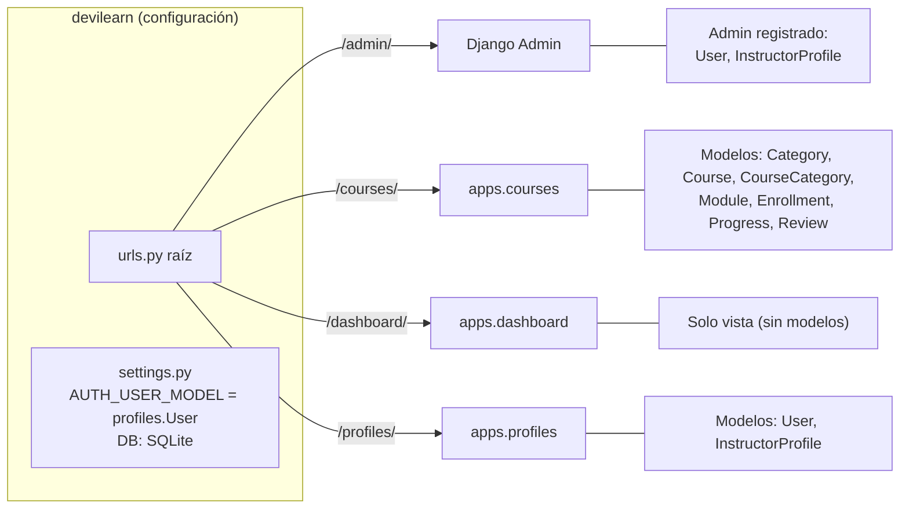
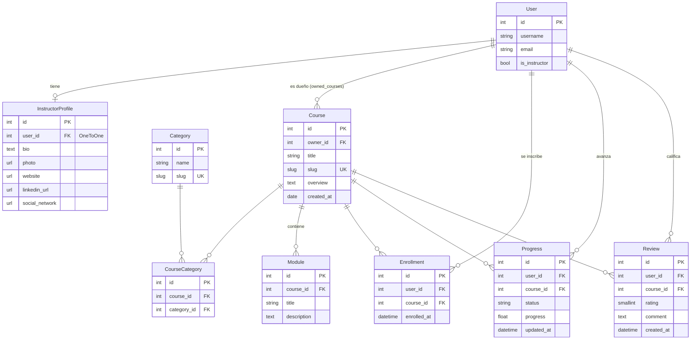

# DeviLearning

Plataforma de cursos en línea construida con Django 5.2, SQLite y Tailwind CSS.

## Estado del backend

### Arquitectura de apps



### Rutas implementadas

| Prefijo      | Ruta        | Vista            | Nombre          |
|--------------|-------------|------------------|-----------------|
| `/courses/`  | `""`        | `course_list`    | `course_list`   |
| `/courses/`  | `detail/`   | `course_detail`  | `course_detail` |
| `/courses/`  | `lessons/`  | `course_lessons` | `course_lessons`|
| `/dashboard/`| `""`        | `index`          | `dashboard`     |
| `/profiles/` | `""`        | `index`          | `profiles`      |
| `/admin/`    | —           | Django Admin     | —               |

### Diagrama de modelos (ER)



> `Course ↔ Category` es una relación muchos a muchos a través de `CourseCategory`.
> `Enrollment`, `Progress` y `Review` tienen restricción única `(user, course)`.

### Avance

- [x] Usuario personalizado (`profiles.User`) con `is_instructor`
- [x] Perfil de instructor y registro en el admin
- [x] Modelos de cursos, módulos, inscripciones, progreso y reseñas
- [x] Migraciones iniciales
- [x] Rutas y vistas base (plantillas) de cursos, dashboard y perfiles
- [ ] Admin para los modelos de `courses`
- [ ] Lógica de vistas con datos reales (hoy solo renderizan plantillas)
- [ ] Autenticación (login/registro)
- [ ] Modelo de lecciones (la ruta `lessons/` existe, sin modelo aún)

## Desarrollo

```bash
python manage.py migrate
python manage.py runserver
npm run build   # o el script de Tailwind definido en package.json
```
